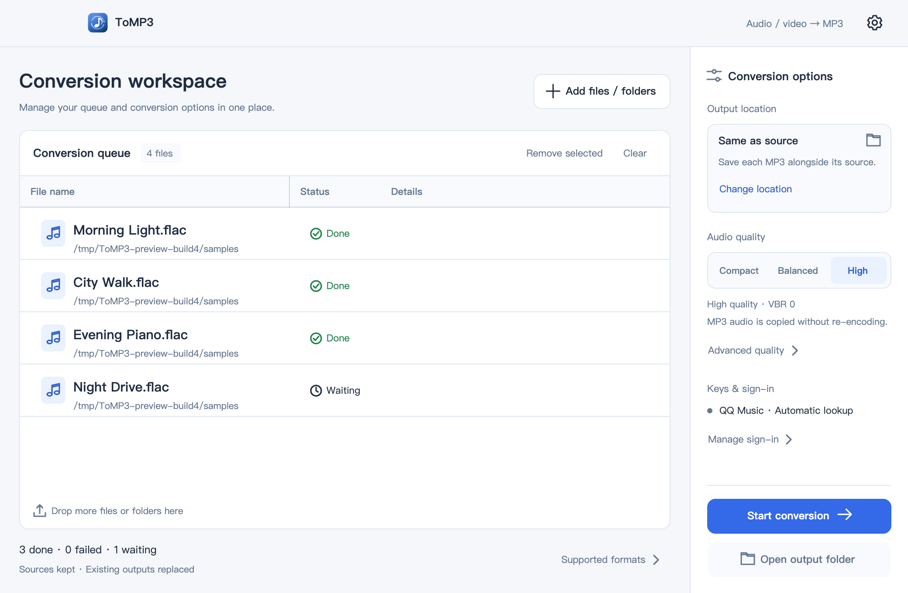
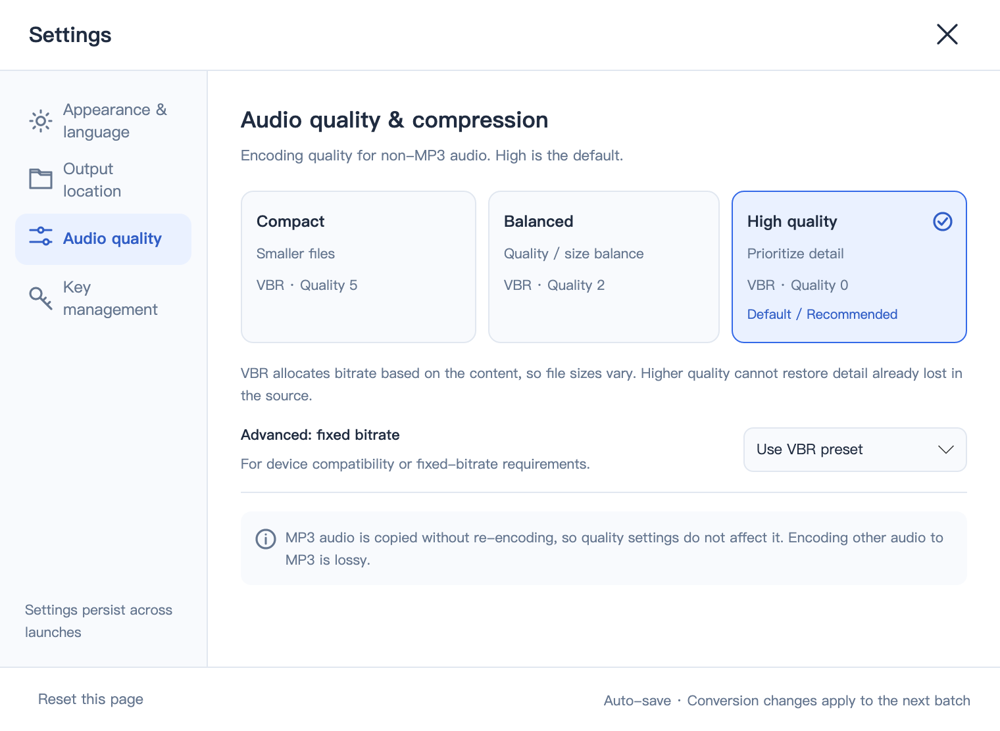

# ToMP3

[中文](README.ZH.md) | English

A small desktop tool that **actually converts** encrypted audio from music platforms, common audio files, and audio tracks from videos into MP3, for macOS (Apple Silicon).

> **⚠ macOS only**: the Windows build is not part of this project's supported surface and is not described here.

Not a rename: when decryption yields FLAC, OGG, M4A and similar formats, audio is transcoded with the bundled FFmpeg (libmp3lame). **High quality is the default (VBR `-q:a 0`)**; existing MP3 tracks are copied without re-encoding. Transcoding is lossy — the app never claims to preserve original audio quality.

## Screenshots



<details>
<summary>Audio quality settings</summary>



</details>

These images are offscreen renders of the real Avalonia window controls from the 1.1.0 (build 4) published assemblies, using generated audio samples. They are not HTML mockups; OS window buttons and native menus are not included.

## Supported formats

| Source | Formats |
|---|---|
| NetEase Cloud Music | `.ncm` |
| QQ Music | `.qmc0/2/3/4/6/8` `.qmcflac` `.qmcogg` `.mflac*` `.mgg*` `.tkm` `.tm0/2/3/6` |
| Kugou Music | `.kgm` `.kgma` `.kgm.flac` `.kgg` `.vpr` `.vpr.flac` |
| Kuwo Music | `.kwm` |
| Xiami Music | `.xm` |
| Ximalaya | `.x2m` `.x3m` |
| Baidu Music | `.bkc*` |
| Migu Music | `.mmp4` |
| Plain audio | `.flac` `.ogg` `.oga` `.opus` `.m4a` `.aac` `.wav` `.aiff` `.wma` `.ape` |
| Video | `.mp4` `.mkv` `.mov` `.avi` `.webm` `.flv` `.wmv` `.asf` `.m4v` `.mpg` `.mpeg` `.ts` `.mts` `.m2ts` `.3gp` `.3g2` `.vob` `.ogv` `.rm` `.rmvb` |

The decryptors and FFmpeg ship inside the app (`ncmdump`, `um`, FFmpeg 8.0.3 with statically linked LAME 3.100), so nothing has to be installed.

## 1.1.0: workspace and settings

Manage the queue on the left and choose output settings on the right. Expand the supported-format list at the bottom left when needed.

- **Settings:** the gear in the upper-right corner, or **ToMP3 → Settings…** in the macOS app menu (`⌘,`).
- **Appearance and language:** Light, Dark, or System (default). The interface defaults to Chinese; choose English in Settings. Changes apply immediately.
- **Output location:** alongside each source, or a shared destination folder. Cancelling the picker leaves settings unchanged.
- **Audio quality:** High (default, VBR 0), Balanced (VBR 2), or Compact (VBR 5). Advanced settings offer fixed CBR at 128 / 192 / 256 / 320 kbps.
- **Key management:** check local QQ Music sign-in information and view sign-in help. Raw credentials are never displayed, saved, or exported; song keys are not cached. Manual key and database import are not available in this release.

Preferences are saved automatically to `~/Library/Application Support/ToMP3/settings.json`. Theme and language changes are immediate. Each batch keeps the output location and quality selected when conversion starts; changes made during conversion apply to the next batch.

Quality settings affect only audio that needs encoding. MP3 is lossy; higher quality cannot recover detail already lost in the source, and does not guarantee smaller files.

## Usage

1. Drag files or whole folders into the window, or click **Add files / folders** to use the system picker.
2. Choose the output location and quality on the right. Source files are kept; same-name outputs are replaced.
3. Click **Start conversion**. Files are processed serially; **Stop conversion** cancels the current operation. Failure or cancellation leaves the previous target intact.
4. Statuses are shown per row. Double-click a row or use its context menu to reveal the file in Finder. Completed items do not rerun unless you choose **Convert again**.

Videos use the same window, import controls, and task list as audio. The first audio track is extracted (regardless of the default-track flag), keeping existing tags and attached cover art but discarding video frames. MP3 tracks are copied without re-encoding; other tracks are transcoded to MP3. Files without an audio track fail with an explanation, leaving the source video unchanged.

## Known limitations

- Newer QQ Music (macOS client 19.57+) stores the key of downloaded `.mflac`/`.mgg` files outside the file, so decrypting them needs network access and a QQ Music account that was signed in on this machine when the song was downloaded.
- Missing sign-in, expired credentials, and permission failures have guidance in the selected interface language. “Local sign-in found” only confirms local credential availability; expiry and song permissions are checked during conversion.
- Formats requiring an external database, such as some KuGou `.kgg` files, cannot be guaranteed by extension alone. This release has no database-import option.
- `.mp3` inputs are not claimed: an MP3 is not re-encoded.
- Linux and mobile platforms are out of scope.

## System requirements

- macOS 12+ (Apple Silicon)

## Build

Requires the .NET 8 SDK; see [AGENTS.md](AGENTS.md) for the full conventions.

```bash
# build
dotnet build src/ToMP3/ToMP3.csproj -c Release

# run the app from source
dotnet run --project src/ToMP3/ToMP3.csproj

# publish a self-contained macOS arm64 .app
dotnet publish src/ToMP3/ToMP3.csproj -c Release -r osx-arm64 --self-contained true -o dist/ToMP3.app/Contents/MacOS/
codesign --force --deep --sign - dist/ToMP3.app
```

The icon source is `src/ToMP3/Assets/icon.svg`. PNG, ICNS, and ICO exports must retain transparency outside the rounded corners, without a white matte. Update these assets together with the build number in `Info.plist`.

## License

ToMP3 is released under the [MIT](LICENSE) license.

### Bundled third-party tools

| Tool | Purpose | License | Bundled contents |
|---|---|---|---|
| [ncmdump](src/ToMP3/Assets/ncmdump/README.md) | Decrypts `.ncm` | MIT | Copyright notice + full license text (end of `Assets/ncmdump/README.md`) |
| [um](src/ToMP3/Assets/um/README.md) | Decrypts the other vendors' private encrypted formats | MIT | Copyright notice + full license text (end of `Assets/um/README.md`) |
| FFmpeg / ffprobe 8.0.3 | Audio transcoding and video audio extraction | LGPL-2.1 | `Assets/ffmpeg/FFmpeg-LICENSE.txt` + `NOTICE.txt` (with SHA-256) |
| LAME 3.100 | MP3 encoding | LGPL | `Assets/ffmpeg/LAME-LICENSE.txt` |
| TagLib 2.3 (ncmdump dependency) | Audio metadata | LGPL-2.1 / MPL | `Assets/ncmdump/TagLib-LICENSE-*.txt`, `TagLib-AUTHORS.txt` |
| zlib 1.3.1 | PNG cover decoding | zlib | Source and checksums recorded in `Assets/ffmpeg/NOTICE.txt` |

The corresponding source tarballs and `build.sh` are shipped as well (`Assets/<tool>/source/`), satisfying the LGPL rebuild requirement. This project calls the above tools as separate subprocesses and is not linked against them.
